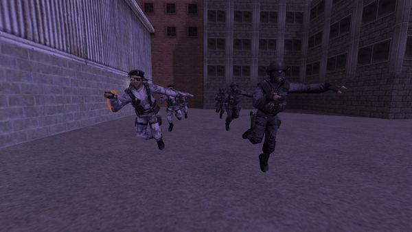

<h1 align="center">Spawn Manager</h1>

<p align="center">
  
</p>

## 📝 Description
Spawn Manager provides a complete runtime spawn editing system for Counter-Strike 1.6.
Spawn points can be created, moved, rotated, deleted and organized directly in-game, with per-map configurations automatically saved and loaded.
- Create, edit and remove spawn points during gameplay
- Supports both Terrorist and Counter-Terrorist spawn points
- Ghost model preview for accurate spawn placement
- Adjustable placement offset with configurable scrolling speed
- Per-map spawn configurations saved automatically
- Optionally load original map spawn points alongside custom ones
- Runtime configuration reload support

## 💬 Commands
- `say /sm` - Opens the Spawn Manager menu.
- `say_team /sm` - Opens the Spawn Manager menu.
- `say /spawn` - Opens the Spawn Manager menu.
- `say_team /spawn` - Opens the Spawn Manager menu.
- `sm_reload` - Reloads the configuration file.
- `spawn_reload` - Reloads the configuration file.

## ⚙️ Configuration
```ini
# [Main Settings]
# SETTING_DEFAULT_MODEL_T   = Default Terrorist player model used for ghost preview
# SETTING_DEFAULT_MODEL_CT  = Default Counter-Terrorist player model used for ghost preview
# SETTING_DEFAULT_SEQUENCE  = Default animation sequence
# SETTING_DEFAULT_FRAMERATE = Default animation playback speed
```

## 🔄 Changelog
```text
* v1.0: Initial release.
```

[](https://www.youtube.com/watch?v=kbdeUie3-SU)
